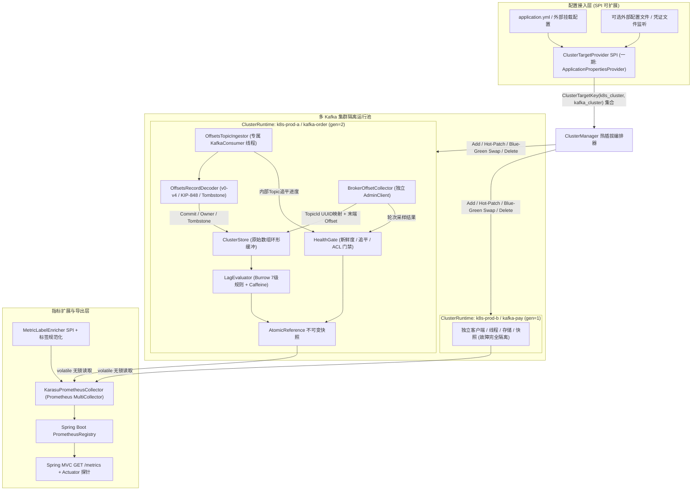
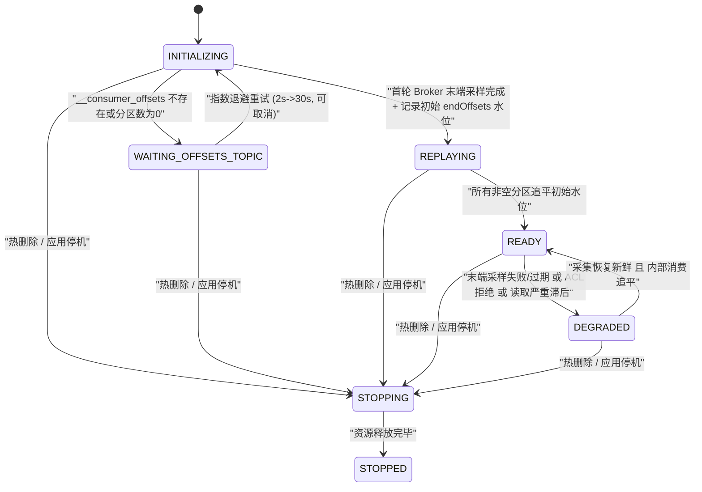

# Karasu 设计文档（v2.0 · Java 17 + Spring Boot 3）

> **文档状态**：定稿草案 v2.0（已吸收全部评审决策，待最终确认后启动一期编码）  
> **日期**：2026-11-24  
> **技术基线**：Java 17 LTS · Spring Boot 3.4/3.5 · `kafka-clients 4.2.0` · Kafka Broker `3.9+`  
> **原理参考**：LinkedIn Burrow `v1.9.6` / `1.9.6-paas.1`、Apache Kafka `4.2.0` 协议定义

---

## 1. 一期范围与已确认决策

| 决策项 | 确认结论 |
|---|---|
| **框架与语言** | **Java 17 LTS + Spring Boot 3.x**（全依赖严格保持 Apache-2.0 / MIT / BSD，日志替换默认 Logback 为 Log4j2） |
| **核心采集方案** | 沿用 Burrow 方案：直接消费 `__consumer_offsets` + 定时采集分区末端 Offset + 滑动窗口 7 级状态评估（完整保留 `STOP` / `STALL` 区分） |
| **多 Kafka 接入** | 单 Karasu 进程原生支持同时接入多套独立 Kafka 集群/进程，彼此故障完全隔离，并支持配置热增删改与扩展接入源 SPI |
| **指标前缀与标签** | 全面切换为 **`karasu`** 前缀（`karasu_kafka_*` / `karasu_cluster_*`）；所有业务与健康指标必带 **`k8s_cluster`**、**`kafka_cluster`** 标签，并预留三层可扩展标签机制 |
| **一期 HTTP 范围** | 仅暴露 Prometheus **`GET /metrics`** 及健康探针；Burrow `/v3/kafka/*` 查询接口、管理接口放入 Backlog |
| **配置来源与交付物** | 一期只交付 **Java 应用**，配置来自 Spring Boot **`application.yml`**（支持外部挂载与动态热加载）；容器镜像与 K8s 清单留待后续接入 Kafka Helm Chart |
| **Kafka 版本下限** | **Kafka 3.9+**（覆盖 3.9.x ~ 4.2.x，纯 KRaft 场景，无需 ZooKeeper 历史兼容代码） |

### 重构核心收益（相对 Burrow v1.9.6 / 1.9.6-paas.1）

1. **多 Kafka 接入故障彻底隔离**：单套 Kafka 不可达、认证失败或 `__consumer_offsets` 尚未创建时，该目标独立退避重试，绝不导致进程退出或拖累其他已接入的 Kafka 集群。
2. **协议解码完备与正确性修复**：完整覆盖 Kafka 3.9–4.2 的 `OffsetCommitValue` v0–v4（含 v4 变长 `compact_string` 边界防护）、`GroupMetadataValue` v0–v4、KIP-848 消费组记录（key 3/5/8 + `TopicId` UUID 映射）、Offset Tombstone 及时清理，默认 `read_committed` 消除 EOS 事务回滚污染。
3. **数据健康门禁与防陈旧暴露**：分离进程探针与单集群数据健康；回放未追平、断网超时或 ACL 撤销时，撤下陈旧业务 Lag 指标，靠 `karasu_cluster_up` 等健康指标精确告警。
4. **GC 友好与无锁抓取**：每集群独立内存分片 + 原始数组环形缓冲（热路径零对象分配）+ 后台不可变快照发布，Prometheus 抓取通过原生 `MultiCollector` 无锁流式输出，彻底消除全局互斥锁与旧指标残留。

---

## 2. 技术栈与合规清单

所有核心依赖均为 **Apache-2.0 / MIT / BSD**，规避原 Go 版本的 MPL-2.0 间接依赖以及 Logback（EPL/LGPL）等法务敏感项：

| 模块/能力 | 选型 | 许可证 | 说明 |
|---|---|---|---|
| 语言与运行时 | Java 17 LTS | GPLv2+CE | 使用 `record`、`sealed interface`、G1GC/ZGC；注意 Java 17 无虚拟线程，采用经典有界线程模型 |
| 应用框架 | Spring Boot `3.4.x` / `3.5.x`（`spring-boot-starter-web` + `actuator`） | Apache-2.0 | 嵌入式容器默认 Tomcat（Apache-2.0），通过 `@ConfigurationProperties` 强类型绑定 `application.yml` |
| 日志框架 | `spring-boot-starter-log4j2`（排除默认 `spring-boot-starter-logging`） | Apache-2.0 | 纯 Apache-2.0，支持结构化 JSON 日志与高性能异步写入 |
| Kafka 客户端 | `org.apache.kafka:kafka-clients:4.2.0` | Apache-2.0 | 向下兼容 Kafka 3.9+；原生支持 SCRAM-SHA-256/512、PEM 格式 TLS/mTLS、KIP-848。**不引入** Broker 侧内部模块 `kafka-group-coordinator` |
| Prometheus 导出 | `io.micrometer:micrometer-registry-prometheus`（底层 `prometheus-metrics-core:1.x`） | Apache-2.0 | JVM/HTTP 自监控走 Micrometer；海量动态 Kafka 指标直接注册原生 `MultiCollector` 到 `PrometheusRegistry`，零 Meter 泄漏 |
| 评估缓存 | `com.github.ben-manes.caffeine:caffeine` | Apache-2.0 | 每集群独立有界 TTL 缓存，支持精确失效与命中率观测 |
| 构建与合规 | Maven 3.9+ + `cyclonedx-maven-plugin` + `license-maven-plugin` | Apache-2.0 | 支持内网离线私服构建，CI 自动产出 SBOM 与第三方许可证白名单校验 |

---

## 3. 总体架构与模块划分

### 3.1 逻辑架构图



### 3.2 Maven 多模块工程结构（一期）

```text
karasu/
├── pom.xml                       # 父 POM（Spring Boot BOM、Java 17、依赖许可证与 SBOM 插件）
├── karasu-protocol/              # 纯领域模型、状态枚举、__consumer_offsets 字节解码器（零框架依赖）
├── karasu-core/                  # ClusterManager、ClusterRuntime、双路采集、紧凑存储、评估引擎、SPI 接口
├── karasu-exporter/              # 标签归一化与 MetricLabelEnricher、Prometheus MultiCollector、/metrics 端点
└── karasu-app/                   # Spring Boot 主程序、@ConfigurationProperties 配置绑定、配置热监听、application.yml
```

> [!NOTE]
> `karasu-protocol` 与 `karasu-core` 不强绑定 Spring Web，核心类均采用构造器注入，便于单元测试和后续扩展（如二期新增 `karasu-k8s` 模块或接入 Kafka Chart）。

---

## 4. 多 Kafka 接入与可扩展标签体系设计

### 4.1 复合目标标识（`ClusterTargetKey`）

当单个 Karasu 进程同时监控来自**不同 K8s 集群**的多个 Kafka 实例时，仅靠 `kafka_cluster` 名称可能产生碰撞（例如 `k8s-east` 和 `k8s-west` 下均存在名为 `kafka-core` 的集群）。

因此 Karasu 以二元组作为内部全局唯一主键：

```java
public record ClusterTargetKey(
    String k8sCluster,    // 对应标签 k8s_cluster，必填
    String kafkaCluster   // 对应标签 kafka_cluster，必填
) {
    public String canonicalId() {
        return k8sCluster + "/" + kafkaCluster;
    }
}
```

- 同一个 Karasu 进程内，`(k8s_cluster, kafka_cluster)` 必须唯一；启动和热加载阶段校验重复键并拒绝冲突配置。
- 日志 MDC 字段统一附带 `k8s_cluster`、`kafka_cluster`、`gen`，排障按集群精准过滤。

### 4.2 三层可扩展标签体系

指标标签按以下三层合并，优先级从低到高为 **L1 < L2 < L3**，兼顾现网必填要求与未来多租户/多地域扩展：

| 层级 | 配置/扩展位置 | 作用范围 | 典型示例 |
|---|---|---|---|
| **内置固定标签** | 强制生成，不可覆盖 | 所有指标 | `k8s_cluster`、`kafka_cluster`（及业务指标的 `consumer_group`、`topic`、`partition`） |
| **L1 全局公共标签** | `karasu.metrics.common-labels` | 本进程产出的全部 Kafka 与集群健康指标 | `env: prod`、`region: cn-east-1`、`collector_zone: zone-a` |
| **L2 集群级扩展标签** | `karasu.clusters[].labels` | 单个接入的 Kafka 集群 | `namespace: daas`、`tenant: billing`、`instance_id: kfk-01`、`tier: gold` |
| **L3 编程式增强 SPI** | Spring Bean 实现 `MetricLabelEnricher` | 集群级或消费组/Topic 级动态标签扩展 | 后续对接平台 CMDB 按 group/topic 附加 `app_code`、`owner_team` 等 |

```java
public interface MetricLabelEnricher {
    /** 附加到该集群全部指标（含健康指标与业务指标） */
    default Map<String, String> enrichClusterLabels(ClusterSpec spec) {
        return Map.of();
    }

    /** 附加到特定消费组指标（默认空，谨慎控制基数） */
    default Map<String, String> enrichGroupLabels(ClusterSpec spec, String consumerGroup) {
        return Map.of();
    }
}
```

#### Prometheus 标签合法性与 Schema 一致性保障

1. **严格校验**：所有扩展标签 Key 必须匹配 `^[a-zA-Z_][a-zA-Z0-9_]*$`，禁止以 `__` 开头，禁止覆盖保留标签名（`k8s_cluster`, `kafka_cluster`, `consumer_group`, `topic`, `partition`, `state`, `record_type`, `reason`, `phase`）。
2. **统一 Schema 归一化**：在 `KarasuPrometheusCollector` 构造同一 Metric Family 的 `GaugeSnapshot` 前，自动汇总所有活跃集群涉及的扩展标签 Key 排序并集（同时支持配置 `karasu.metrics.declared-extra-label-keys` 固定列顺序）；未配置某个扩展键的集群自动填充空字符串 `""`（Prometheus 中空值标签语义等价于无该标签），保证 `prometheus-metrics-core` 1.x 与 OpenMetrics 格式 100% 合规，绝不因不同集群扩展标签不同而报错。
3. **基数防线**：默认限制每个集群最多配置 8 个扩展标签（可配置），避免无意引入高基数动态值压垮 TSDB。

### 4.3 多 Kafka 接入与动态配置扩展点（`ClusterTargetProvider`）

为同时满足"一期基于 `application.yml` 接入多套 Kafka"与"二期无缝对接 Kafka Helm Chart / 配置中心 / CRD"，接入层抽象出统一的 `ClusterTargetProvider` SPI：

- **一期内置实现 1：`ApplicationPropertiesClusterProvider`**
  - 读取 Spring Boot `application.yml` 中的 `karasu.clusters` 列表，支持多个 Kafka 集群配置及环境变量/Secret 文件路径占位符（如 `${KAFKA_A_PASSWORD}` 或 `password-file: /var/run/secrets/...`）。
- **一期内置实现 2（可选开关）：`WatchedYamlClusterProvider`**
  - 当通过 `--spring.config.additional-location` 或 `karasu.config.watch-locations` 指定外部 YAML 文件或目录（例如 `conf.d/*.yaml`，后续每个 Kafka Chart 可独立渲染一个文件）时，后台轮询文件 SHA-256 摘要（轮询优于 `WatchService`，天然兼容 Kubernetes ConfigMap/Secret 的 symlink 原子替换！）。
  - 检测到配置或挂载的密码/证书文件内容变化时，自动触发 `ClusterManager.reconcile(newSpecs)` 执行增量 Diff 与热插拔。

---

## 5. 核心采集、存储与评估引擎设计

### 5.1 `__consumer_offsets` 协议解码（适配 Kafka 3.9 ~ 4.2）

Kafka 3.9+ 已全面采用现代协调器记录格式，但集群升级后日志中仍可能留存压缩后的旧版本记录。`OffsetsRecordDecoder` 采用纯 `ByteBuffer` 实现（无外部 I/O、零重型 Broker 依赖）：

| Key Type (`int16`) | 记录类型 | 支持 Value 版本 | Karasu 行为 |
|---|---|---|---|
| `0`, `1` | `LegacyOffsetCommitKey` / `OffsetCommitKey` | `v0`, `v1`, `v2`, `v3`, `v4+` (flexible) | 解码 `(group, topic, partition)` -> `(offset, commitTimestamp)`；**v4 按 unsigned varint 解码 `compact_string` metadata 并跳过未知 tagged fields**；**Value 为 `null`/空（Tombstone）时主动删除该分区消费状态** |
| `2` | `GroupMetadataKey`（Classic 组） | `v0`–`v4+` (flexible) | Tombstone 删除整组；`protocolType=="consumer"` 时更新成员 `clientHost`/`clientId` 与分区归属；成员为空时清空归属 |
| `3` | `ConsumerGroupMetadataKey`（KIP-848 组） | `v0+` | Tombstone 删除整个 KIP-848 消费组 |
| `5` | `ConsumerGroupMemberMetadataKey`（KIP-848 成员） | `v0+` (flexible) | 维护 `(groupId, memberId) -> (clientId, clientHost, instanceId)`；Tombstone 移除成员并清理归属 |
| `8` | `ConsumerGroupCurrentMemberAssignmentKey`（KIP-848 分配） | `v0+` (flexible) | 解析 `AssignedPartitions` 中的 `(TopicId UUID, partitions[])`，通过 `BrokerOffsetCollector` 维护的 `Map<Uuid, String>` 映射表还原 `topicName` 并写入 `owner`/`clientId` |
| `4`, `6`, `7`, `16` | KIP-848 分区元数据 / 目标分配 / 正则订阅 | — | 静默识别计数，不刷 Warn 日志 |
| `10`–`15` / `17, 19`–`23` | Share Group / Streams Group 元数据 | — | 一期静默识别计数（Streams 组提交仍走 Key 1，Lag 正常计算；Share Group 放入 Backlog） |
| 未知 Key Type | 未来版本扩展记录 | — | 计入 `karasu_cluster_decode_errors_total` 并按类型限流输出一次 Warn，不中断消费 |

**防御性边界检查**：所有 `unsigned varint` 限读 5 字节；变长字符串与数组长度严格校验 `0 <= len <= remaining` 且不超过上限（默认 1 MiB），杜绝畸形记录导致的 OOM 或偏移错位。

### 5.2 内部 Topic 消费与状态机（`OffsetsTopicIngestor`）

- **单线程独占 `KafkaConsumer`**：每集群默认分配 1 个专属守护线程（`karasu-offsets-<k8s>-<kafka>-gen<N>`，大流量集群可配 `offsets-consumer-threads: 2..4` 按分区均分），显式 `assign()` 全部 `__consumer_offsets` 分区（**不加入 Kafka 消费组**，无 Rebalance 开销）。
- **事务安全**：默认配置 `isolation.level=read_committed`（可按集群覆盖），过滤未提交及回滚的 EOS 事务提交记录。
- **优雅关闭**：外部停机/热删仅置位 `stopping` 并调用 `consumer.wakeup()`，由所属线程捕获 `WakeupException` 后自行 `close()`，严格遵守 `KafkaConsumer` 线程安全约束。
- **内部 Topic 缺失等待与回放追平状态机**：



- **`EARLIEST_THEN_LIVE`（默认回放模式）**：先等 `BrokerOffsetCollector` 完成首轮业务 Topic 元数据与末端 Offset 采样，再记录 `__consumer_offsets` 各分区 `endOffsets` 作为追平目标，随后 `seekToBeginning()` 顺序回放；追平前处于 `REPLAYING` 状态（不发布半成品业务 Lag，彻底消除 Burrow `backfill-earliest` 临时放大 Lag 的问题）。
- **取消伪消费组**：不再制造 `burrow-<name>` 假业务组，改用独立的 `karasu_cluster_offsets_lag_total` 与 `karasu_cluster_offsets_caught_up` 指标表达内部追平状态。

### 5.3 Broker 末端 Offset 采集（`BrokerOffsetCollector`）

每集群独立 `AdminClient`（Kafka 3.9+ 全部接口原生支持，无需降级逻辑）：

1. **元数据刷新（默认 `topic-refresh-seconds: 60`）**：`listTopics(includeInternal=true)` + 分批 `describeTopics(batchSize=200)` 获取分区数、Leader 与 **`TopicId (UUID)`**；识别删除 Topic 或重建（`TopicId` 变化 / 分区缩减）并同步清理 `ClusterStore`。
2. **末端采样（默认 `offset-refresh-seconds: 15`）**：分批 `listOffsets(OffsetSpec.latest())`（支持按集群配 `isolation-level: READ_UNCOMMITTED | READ_COMMITTED`）；带单次超时保护；仅当本轮已知在线分区全部成功时标记 `collectionSuccess = true` 并刷新时间戳。
3. **可选 Groups Reaper（默认关闭）**：开启后定期调用 `adminClient.listGroups()` 比对内存中的消费组，兜底清理漏收 tombstone 的幽灵组。

### 5.4 紧凑内存存储（`ClusterStore`）与评估引擎（`LagEvaluator`）

- **每集群独立存储**：集群删除直接丢弃整个 `ClusterStore` 引用由 GC 整体回收，彻底避免跨集群内存泄漏。
- **原始数组环形缓冲**：每个 `(group, topic, partition)` 槽位用 5 个定长 `long[intervals]` 数组存储（`offsets / orders / commitTimestamps / observedTimestamps / commitLags`），热路径写入**零新对象分配**，单槽位内存约 **550–650 Bytes**，对象数较链表实现减少 10 倍以上。
- **完全保留 Burrow 窗口与 7 级评估语义**：
  - 按 `order` 保序插入、`min-distance` 频繁提交合并（保留前一条 timestamp）、`expire-group`（后台定时扫描 + 查询惰性双路径清理）、单集群基数上限护栏（`max-groups` / `max-group-partitions` 防 OOM）。
  - 7 级状态枚举值与优先级完全一致：`NOTFOUND(0)`、`OK(1)`、`WARN(2)`、`ERR(3)`、`STOP(4)`、`STALL(5)`、`REWIND(6)`，新增时钟偏移保护。
- **无锁不可变快照发布**：每集群 Caffeine 缓存（默认 10s TTL）+ 后台周期预构建只读 `ClusterMetricsSnapshot` 原子替换；`/metrics` 抓取直接遍历不可变快照流式编码，无全局互斥锁、无过期指标残留。

### 5.5 多集群热插拔编排（`ClusterManager`）

- 按 `ClusterTargetKey(k8sCluster, kafkaCluster)` 串行协调单个集群的变更，不同集群并发执行；每次重建递增 `generation` 版本屏障，丢弃旧实例迟到回调。
- **热操作语义**：
  - **新增**：校验配置 → 启动独立 `ClusterRuntime` → 不影响已有集群。
  - **非连接参数更新**（过滤规则、评估参数、扩展标签、采样周期）：原地热更新，**不断连、不回放**。
  - **连接/认证/TLS 变更**：默认蓝绿切换（启动 `gen+1` 追平后再原子切换并关闭 `gen`，新配置失败时保留旧实例并告警）；也支持配置 `swap-policy: RECREATE` 应对旧密钥立即失效场景。
  - **删除**：立即摘除快照发布指针（`/metrics` 立刻停止输出该集群指标）→ `wakeup` 停消费线程、关闭 `AdminClient` → 释放内存。

---

## 6. 指标体系与一期 HTTP 接口

### 6.1 数据健康门禁（Quality Gate）

单集群满足 `headFresh && offsetsCaughtUp && clusterReachable` 时，`karasu_cluster_up = 1` 并发布该集群的业务 Lag 指标；断网超新鲜度阈值、ACL 拒绝或回放未追平时，`karasu_cluster_up = 0` 且**撤下陈旧业务 Lag 指标**（默认 `publish-stale-on-degraded: false`），杜绝假数据误导。

### 6.2 Prometheus 指标清单（全量 `karasu` 前缀）

> 下表所有指标除列出标签外，均自动附加全局 `common-labels`、集群级 `labels` 及 `MetricLabelEnricher` 产出的扩展标签（记作 `...extra`）。

#### A. 业务消费 Lag 与状态指标（通过健康门禁时输出）

| 指标名 | 类型 | 标签 | 说明 |
|---|---|---|---|
| `karasu_kafka_consumer_lag_sum` | Gauge | `k8s_cluster`, `kafka_cluster`, `consumer_group`, `...extra` | 消费组跨所有 Topic 和分区的当前总 Lag（遵循 OpenMetrics 规范，Gauge 不使用 `_total` 后缀） |
| `karasu_kafka_consumer_status` | Gauge | `k8s_cluster`, `kafka_cluster`, `consumer_group`, `...extra` | 组状态枚举值（0 NOTFOUND / 1 OK / 2 WARN / 3 ERR） |
| `karasu_kafka_consumer_partition_lag` | Gauge | `k8s_cluster`, `kafka_cluster`, `consumer_group`, `topic`, `partition`, `...extra` | 单分区近似 Lag（下界 0） |
| `karasu_kafka_consumer_current_offset` | Gauge | `k8s_cluster`, `kafka_cluster`, `consumer_group`, `topic`, `partition`, `...extra` | 最新已提交 Offset（可配 `require-complete-window`） |
| `karasu_kafka_topic_partition_status` | Gauge | `k8s_cluster`, `kafka_cluster`, `consumer_group`, `topic`, `partition`, `...extra` | 分区状态枚举值（1 OK / 2 WARN / 4 STOP / 5 STALL / 6 REWIND） |
| `karasu_kafka_topic_partition_offset` | Gauge | `k8s_cluster`, `kafka_cluster`, `topic`, `partition`, `...extra` | 分区最新末端 Offset（可按集群配置开关控制基数） |

#### B. 逐集群采集健康与容量指标（始终输出）

| 指标名 | 类型 | 标签 | 说明 |
|---|---|---|---|
| `karasu_cluster_up` | Gauge | `k8s_cluster`, `kafka_cluster`, `...extra` | 集群采集整体健康门禁（1=健康可信，0=异常/回放中/过期） |
| `karasu_cluster_state` | Gauge | `k8s_cluster`, `kafka_cluster`, `state`, `...extra` | 独热状态（`INITIALIZING / WAITING_OFFSETS_TOPIC / REPLAYING / READY / DEGRADED`） |
| `karasu_cluster_collection_success` | Gauge | `k8s_cluster`, `kafka_cluster`, `...extra` | 最近一轮末端 Offset 采样是否覆盖全部已知在线分区（1/0） |
| `karasu_cluster_collection_last_success_timestamp_seconds` | Gauge | `k8s_cluster`, `kafka_cluster`, `...extra` | 最近完整末端采样 Unix 时间戳 |
| `karasu_cluster_offsets_caught_up` | Gauge | `k8s_cluster`, `kafka_cluster`, `...extra` | `__consumer_offsets` 消费是否已追平（1/0） |
| `karasu_cluster_offsets_lag` | Gauge | `k8s_cluster`, `kafka_cluster`, `...extra` | 读取 `__consumer_offsets` 自身的剩余积压消息数 |
| `karasu_cluster_tracked_groups` | Gauge | `k8s_cluster`, `kafka_cluster`, `...extra` | 内存当前跟踪的消费组数 |
| `karasu_cluster_tracked_partitions` | Gauge | `k8s_cluster`, `kafka_cluster`, `...extra` | 内存当前跟踪的 `(group, topic, partition)` 槽位数 |
| `karasu_cluster_cardinality_limit_reached` | Gauge | `k8s_cluster`, `kafka_cluster`, `...extra` | 是否触发单集群基数保护上限（1/0） |
| `karasu_cluster_decode_errors_total` | Counter | `k8s_cluster`, `kafka_cluster`, `record_type`, `reason`, `...extra` | 内部记录解码异常或未知类型计数 |
| `karasu_cluster_reconcile_errors_total` | Counter | `k8s_cluster`, `kafka_cluster`, `phase`, `...extra` | 配置热加载/蓝绿切换失败计数 |
| `karasu_snapshot_build_duration_seconds` | Histogram | `k8s_cluster`, `kafka_cluster` | 后台快照构建耗时 |

> 此外通过 Spring Boot Micrometer 自动输出 JVM 堆/非堆内存、GC 暂停、线程数及 HTTP 请求耗时等进程自监控指标。

### 6.3 一期 HTTP 端点（极简只读面）

一期关闭所有非必需业务 REST 接口与管理写接口，仅保留：

| 路径 | 方法 | 说明 |
|---|---|---|
| `/metrics` | `GET` | Prometheus 主抓取端点（直接对接 `PrometheusMeterRegistry`，支持标准 OpenMetrics / Text 0.0.4 内容协商；支持可选 `?kafka_cluster=` / `?k8s_cluster=` 排障过滤） |
| `/actuator/health/liveness` | `GET` | 进程存活探针（不与单个 Kafka 集群状态绑定） |
| `/actuator/health/readiness` | `GET` | 进程就绪探针（Spring 上下文与采集调度启动完成即 UP，单 Kafka 故障不导致整进程摘流） |

---

## 7. Spring Boot `application.yml` 配置设计

一期全部配置均通过 Spring Boot 标准 `application.yml`（支持 `${ENV_VAR}` 及外部文件挂载）驱动，完整结构示例如下：

```yaml
server:
  port: 8000

management:
  endpoints:
    web:
      exposure:
        include: health              # 仅暴露健康探针，/metrics 由专用只读控制器提供
  endpoint:
    health:
      probes:
        enabled: true
      show-details: never

karasu:
  config:
    # 可选：启用外部配置/凭证文件轮询热加载（兼容 K8s ConfigMap/Secret 挂载更新）
    watch-enabled: true
    watch-interval-seconds: 15
    # 可选：额外监听的目录（如 conf.d/*.yaml，便于后续多 Kafka 实例按文件独立接入）
    additional-cluster-dirs: []

  metrics:
    prefix: karasu_kafka
    snapshot-refresh-seconds: 10
    publish-stale-on-degraded: false  # 集群断网/过期后撤下陈旧业务 Lag
    require-complete-window-for-offset: true
    max-extra-labels-per-cluster: 8
    # L1 全局公共扩展标签（附加到本进程全部指标）
    common-labels:
      env: prod
      region: cn-east-1
    # 可选：显式固定扩展标签键集合（未设置的集群自动补空串）
    declared-extra-label-keys:
      - env
      - region
      - namespace
      - tenant

  defaults:
    # 各集群未单独指定时继承以下默认值
    collection:
      offset-refresh-seconds: 15
      topic-refresh-seconds: 60
      start-mode: EARLIEST_THEN_LIVE  # EARLIEST_THEN_LIVE | LATEST_ONLY
      isolation-level: READ_COMMITTED # READ_COMMITTED | READ_UNCOMMITTED
      offsets-consumer-threads: 1
      groups-reaper-seconds: 0        # 0 表示关闭
      swap-policy: BLUE_GREEN         # BLUE_GREEN | RECREATE
    evaluation:
      intervals: 10
      min-distance-seconds: 1
      expire-group-seconds: 604800    # 7 天
      allowed-lag: 0
      minimum-complete: 1.0
      cache-expire-seconds: 10
    limits:
      max-groups: 10000
      max-group-partitions: 200000

  # 支持接入多套独立 Kafka 集群/进程，(k8s-cluster, kafka-cluster) 构成唯一键
  clusters:
    - k8s-cluster: k8s-cn-east-01
      kafka-cluster: kafka-order-prod
      bootstrap-servers:
        - kafka-order-0.daas.svc:9092
        - kafka-order-1.daas.svc:9092
      # L2 集群级扩展标签
      labels:
        namespace: daas
        tenant: order-team
      auth:
        security-protocol: SASL_PLAINTEXT   # PLAINTEXT | SSL | SASL_PLAINTEXT | SASL_SSL
        sasl-mechanism: SCRAM-SHA-512       # SCRAM-SHA-512 | SCRAM-SHA-256 | PLAIN
        username: ${KARASU_ORDER_USERNAME:}
        password: ${KARASU_ORDER_PASSWORD:}
        # 也支持直接读取挂载的凭证文件，避免密码进入环境变量：
        # username-file: /etc/karasu/secrets/order/username
        # password-file: /etc/karasu/secrets/order/password
      tls:
        enabled: false
        # 支持原生 PEM 文件，无需转换 JKS
        ca-file: ""
        cert-file: ""
        key-file: ""
      filters:
        group-allowlist: ""
        group-denylist: ""
        export-topic-partition-offset: true

    - k8s-cluster: k8s-cn-east-02
      kafka-cluster: kafka-pay-prod
      bootstrap-servers:
        - kafka-pay.tenant-b.svc:9093
      labels:
        namespace: tenant-b
        tenant: pay-team
      auth:
        security-protocol: SASL_SSL
        sasl-mechanism: SCRAM-SHA-512
        username-file: /etc/karasu/secrets/pay/username
        password-file: /etc/karasu/secrets/pay/password
      tls:
        enabled: true
        ca-file: /etc/karasu/certs/pay/ca.crt
```

---

## 8. JVM 资源与线程预算参考

> [!IMPORTANT]
> 以下基于数据结构布局估算，正式接入大规模生产前需按目标集群规模压测校准。

- **线程模型（单进程接入 $C$ 套 Kafka 集群）**：
  - 每集群固定：`1` 个 `OffsetsTopicIngestor` 线程 + `1` 个 `AdminClient` 网络线程。
  - 共享有界池：采集调度池（8–16 线程）+ 快照构建池（4 线程）+ Tomcat HTTP 池（8–16 线程）。
  - 合计约 $2C + 30$ 个线程；接入 30 套 Kafka 仅约 ~90 个常驻线程。
- **堆内存估算**：
  - 每 `(group, topic, partition)` 槽位（`intervals=10`）约 **550–650 Bytes**。
  - 单进程接入 20 套集群、总计 20 万活跃 `(group, topic, partition)` 槽位：核心存储堆约 140 MiB，叠加 Spring Boot 运行时、Caffeine 缓存、双份不可变快照及 Kafka 拉取缓冲，推荐总内存配额 **`1.5Gi–2Gi`**，`-XX:MaxRAMPercentage=65.0`、`-XX:+UseG1GC`、`-XX:MaxGCPauseMillis=100`（超过 4 GiB 堆可切换 `-XX:+UseZGC`）。

---

## 9. 一期测试与验证矩阵

| 层级 | 覆盖重点 | 验收标准 |
|---|---|---|
| **L1 协议契约 & Fuzz** | `OffsetCommitValue` v0/v1/v2/v3/v4（含 0/1/126/127/130 字节及多字节 UTF-8、恶意 varint、截断）、`GroupMetadataValue` v0–v4、KIP-848 key 3/5/8 + `TopicId` UUID 映射、Offset/Group Tombstone | 核心解码包覆盖率 > 90%，畸形字节零崩溃、零 OOM |
| **L2 评估规则黄金测试** | 移植 Burrow `caching_test.go` 全部用例 + `min-distance` 合并 + `order` 乱序插入 + 时钟偏移保护 | 7 级状态输出与 Burrow 规则 100% 对齐 |
| **L3 指标与标签校验** | `k8s_cluster`/`kafka_cluster` 复合主键隔离、三层扩展标签合并与 Schema 归一化、保留标签冲突拦截、集群删除/组过期后旧时序消失 | `PrometheusRegistry` 无冲突报错，OpenMetrics 格式合法 |
| **L4 真实 Kafka 集成测试** | Kafka `3.9.x` 与 `4.2.0` 双 KRaft 集群并存：Classic & KIP-848 消费组（验证 `owner`/`client_id` 完整补齐）、EOS 事务提交与回滚、长 metadata、SCRAM-SHA-512 + PEM TLS、撤销/恢复 `__consumer_offsets` READ ACL、`__consumer_offsets` 延迟创建恢复、外部配置热增删改集群 | 与 `kafka-consumer-groups.sh` 及现网 Burrow `1.9.6-paas.1` 数值三方对账一致；单集群故障/热删零影响其他集群 |

---

## 10. 一期计划与 Backlog

### 一期实施里程碑（纯 Java Spring Boot 应用）

1. **Step 1 · 工程脚手架与协议层（`karasu-protocol`）**：初始化 Maven 四模块工程，实现全版本 `__consumer_offsets` 解码器与 L1 契约/Fuzz 测试。
2. **Step 2 · 核心引擎（`karasu-core`）**：实现 `ClusterStore` 原始数组环形缓冲、`LagEvaluator`（通过 L2 黄金测试）、`BrokerOffsetCollector`、`OffsetsTopicIngestor`（含缺失等待与顺序追平状态机）及 `ClusterManager` 热插拔。
3. **Step 3 · 指标与 Spring Boot 装配（`karasu-exporter` & `karasu-app`）**：实现三层标签归一化、`MetricLabelEnricher` SPI、`KarasuPrometheusCollector`、`GET /metrics`、`application.yml` 强类型绑定与外部文件热监听。
4. **Step 4 · 真机联调与对账**：在 Kafka 3.9 & 4.2 双集群完成 L4 全场景验证与对账，产出可运行 Fat JAR 与离线依赖清单/SBOM。

### Backlog（二期及以后规划）

| 编号 | 模块 | 内容说明 |
|---|---|---|
| **BL-01** | REST 查询与诊断接口 | 只读查询消费组详情（`owner`、`client_id`、窗口首尾提交时间、`complete` 完整度）、单集群健康状态机与各 `__consumer_offsets` 分区追平明细；支持独立管理端口、Bearer Token/mTLS 鉴权，可选兼容 Burrow `/v3/kafka/*` 路径 |
| **BL-02** | 容器镜像与 Kafka Helm Chart 集成 | 基于 Eclipse Temurin 17 + `jlink` 构建 `linux/amd64` & `linux/arm64` 离线精简镜像；接入现有 Kafka Helm Chart 模板、共享 `ServiceMonitor`、Prometheus 告警规则与 Grafana 看板模板 |
| **BL-03** | Kubernetes 原生动态发现（`karasu-k8s`） | 实现 `KubernetesCrdClusterProvider`，监听 `KafkaLagTarget` CR 或现有 Kafka CR 及关联 Secret 自动热轮换，异步回写 CR `status` |
| **BL-04** | 大规模水平分片与高可用 | `StatefulSet` 基于权重的 Rendezvous Hashing 一致性哈希分片 + 基于 K8s `Lease` 的自动故障接管 |
| **BL-05** | 新消费组协议与增强指标 | Share Group（KIP-932）基于 Admin API `listShareGroupOffsets` 的扩展采集；Streams Group（KIP-1071）成员分配解码；基于末端 Offset 历史插值估算消费时间延迟（`lag_seconds`） |
| **BL-06** | 规模压测与容量基线 | 20–50 集群、20 万–50 万槽位高提交速率压测，输出单实例容量推荐表与 GC 调优基线 |
